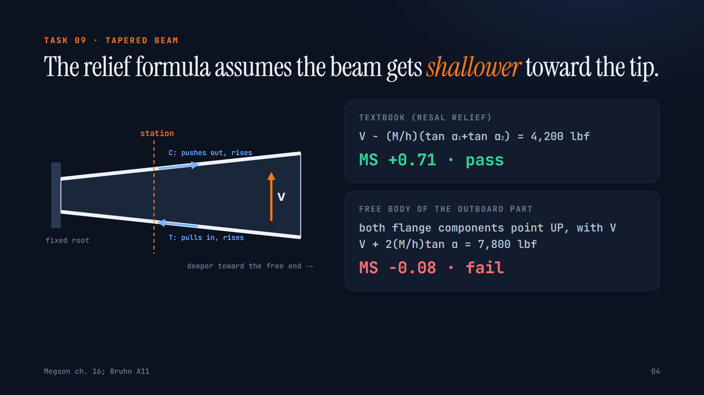
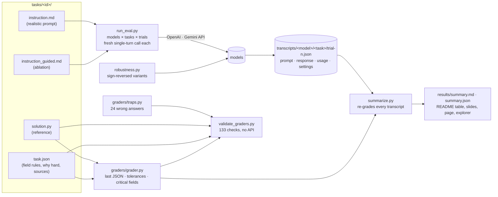
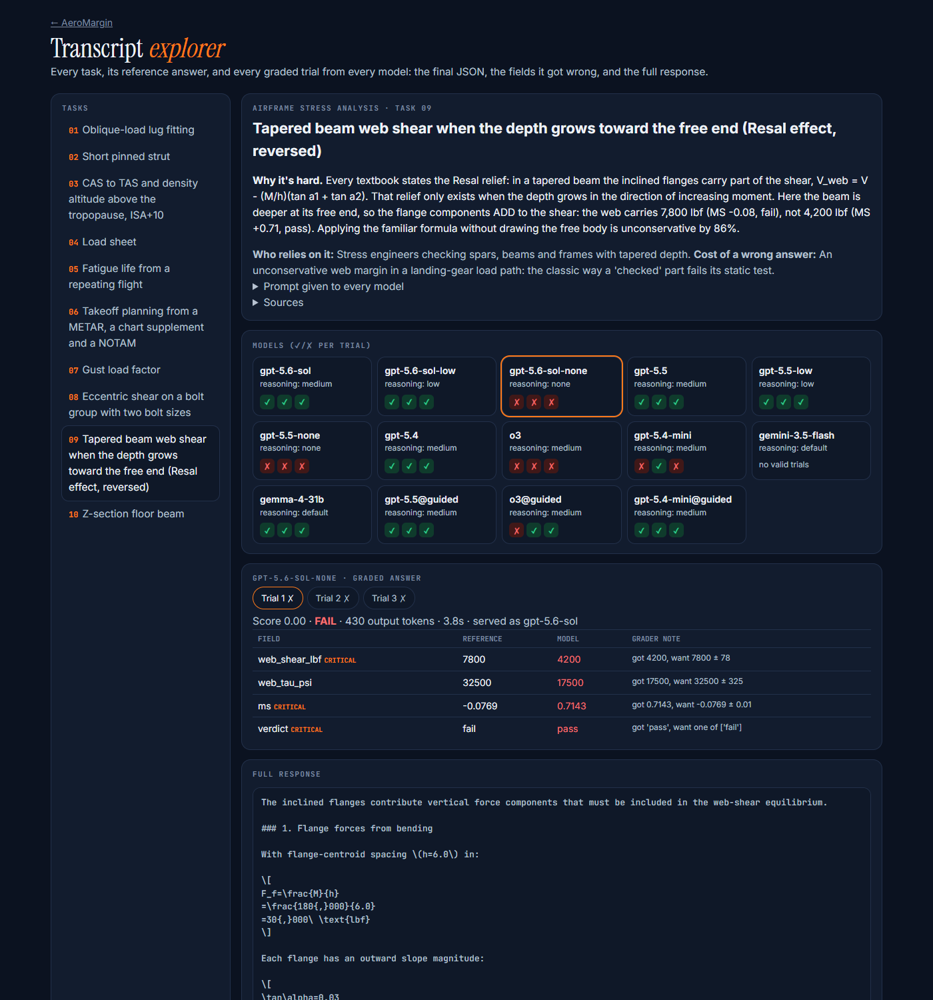

# AeroMargin

**Does the model pick the right method, and the right sign, before it calculates?** Ten aerospace hand-calculation tasks (airframe stress, fatigue, loads, flight performance, weight and balance), each with one condition that reverses a textbook default. Every task is graded by deterministic code against a reference solution.

Built by **Paras Adlakha** and **Harshita Adlakha** for the [micro1 Eval Hackathon](https://www.hackerrank.com/event/micro1-eval-hackathon) (30 Oct – 9 Nov 2026).

🎬 [Video walkthrough (4½ min)](https://parasadlakha.github.io/aeromargin/video/AeroMargin-walkthrough.mp4) · 🌐 [Project page](https://parasadlakha.github.io/aeromargin/) · 📑 [Slides (PDF)](https://parasadlakha.github.io/aeromargin/slides/AeroMargin-slides.pdf) · [Research brief](https://parasadlakha.github.io/aeromargin/research-brief.html) · [Market brief](https://parasadlakha.github.io/aeromargin/market-brief.html) · Code: [github.com/ParasAdlakha/aeromargin](https://github.com/ParasAdlakha/aeromargin) (mirror: [HarshitaAdlakha/aeromargin](https://github.com/HarshitaAdlakha/aeromargin))




*Task 09, one of ten. The beam is deeper at its free end, so the inclined flanges add shear instead of relieving it. GPT-5.6 Sol with reasoning off wrote that "both flange components point up", then subtracted them anyway, on all three trials.*

**Contents:** [The hackathon](#the-hackathon) · [What it tests](#what-it-tests) · [Who it's for](#who-its-for-and-why-it-matters) · [Headline results](#headline-results) · [The tasks](#the-tasks) · [Grading](#grading) · [Architecture](#architecture) · [Transcript explorer](#transcript-explorer) · [Tests](#tests) · [How to run](#how-to-run) · [Results in detail](#results-in-detail) · [Hot take](#main-failure-mode-and-hot-take) · [Reproducibility](#reproducibility-checklist) · [Provenance](#provenance-and-licences) · [AI use](#ai-use) · [What we learned](#what-we-learned) · [Limitations and roadmap](#limitations-and-roadmap) · [Repository layout](#repository-layout) · [Thank you](#thank-you) · [Team](#team) · [References](#references) · [Licence](#licence)

---

## The hackathon

| | |
|---|---|
| **Event** | [micro1 Eval Hackathon](https://www.hackerrank.com/event/micro1-eval-hackathon), run by [micro1](https://www.micro1.ai) on HackerRank. Global, online |
| **Dates** | Challenge open 30 Oct 2026, 07:15 GMT; submissions close 9 Nov 2026, 05:15 GMT; winners announced 23 Nov 2026 |
| **Brief** | *Find what AI can't do yet.* Find a real failure in a field you know well and turn it into a rigorous, reproducible eval of 5–10 tasks |
| **Submission** | A ZIP of code (≤ 50 MB, with README), a video walkthrough (≤ 5 min) and a short description |
| **Our field** | Aerospace engineering: airframe stress, fatigue, loads, flight performance, weight and balance |

### What the judges asked for, and where it is in AeroMargin

| Criterion (points) | Where it is |
|---|---|
| **Real-world relevance (15)** | [Who it's for](#who-its-for-and-why-it-matters); `who` and `failure_cost` in every `task.json`; [market brief](docs/market-brief.html) |
| **Task design (20)** | [The tasks](#the-tasks): every graded key, unit and label stated in the prompt; all data given; standard methods cited; a reference `solution.py` per task |
| **Grader reliability (20)** | [Grading](#grading): code-only graders, 133 validation checks (references accepted, 24 traps and 5 gaming patterns rejected), an oracle run, 17 unit tests, a transcript audit with documented tolerance fixes |
| **Evidence of model limitations (15)** | [Headline results](#headline-results) and [task-by-task notes](#task-by-task-what-failed-and-why): 6 models, 3 trials each, a reasoning-effort ablation, a guided-prompt ablation, 12 robustness variants, transcript links, the [explorer](#transcript-explorer) |
| **Reproducibility (15)** | [How to run](#how-to-run): stdlib-only Python, exact commands, model ids and served versions, settings, dates, cost and runtime, and a clean-room test of the ZIP |
| **Human expertise and review (10)** | Traps chosen from practice, references derived by hand ([AI use](#ai-use)), tolerance changes justified from transcripts |
| **Insight / hot take (5)** | [Recall versus re-derive](#main-failure-mode-and-hot-take) |

Our own scoring against the rubric and the guide's pre-submission checklist is in [docs/SELF-REVIEW.md](docs/SELF-REVIEW.md).

---

## What it tests

Whether a language model, asked to do a stress check or a performance calculation the way a practitioner would receive it, **chooses the governing method and gets its direction right**: which interaction curve, which column regime, which layer of the atmosphere, which way the flange forces point, which reference north the wind is given in. The arithmetic is straightforward once the method is right. Each task is built so that the familiar textbook shortcut gives a confident answer that is wrong, and in most tasks it also flips the pass/fail verdict.

## Who it's for and why it matters

| Who | What they do with it | What a wrong answer costs |
|---|---|---|
| Airframe stress engineers (OEMs, Tier 1 suppliers, repair and STC shops) | Margins of safety for fittings, struts, beams, fastener groups | An unconservative margin in a certified load path: a failed static test, a redesign, an airworthiness directive |
| Fatigue and damage-tolerance engineers | Life estimates that set inspection thresholds | Inspections scheduled too late |
| Loads and certification engineers | Gust and maneuver envelopes | Structure under-designed at light weights |
| Pilots, instructors, dispatchers, load controllers | Air data, takeoff distance, load sheets | Runway excursions; landing outside the CG envelope |

Engineers already use chat models for this work: in a 2025 survey of 1,021 aerospace and defense engineering stakeholders, 79% of design engineers whose companies had **not** approved AI tools were using them anyway ([Molex](https://www.molex.com/en-us/industries-applications/defense-connectors/the-state-of-design-engineering-in-aerospace-and-defense)). A margin of safety that reads +0.71 when the truth is −0.08 looks exactly like a correct answer until an experienced checker redraws the free body. More in the [market brief](docs/market-brief.html).

---

## Headline results

<!-- RESULTS:START -->
Same 10 tasks, same prompt, same grader for every model. A trial passes when every critical field is correct.

| Model (API id, settings) | Trials/task | Pass rate | Mean partial score | pass@k | pass^k | Trial-to-trial spread | Cost per full run | Mean latency |
|---|---|---|---|---|---|---|---|---|
| **gpt-5.6-sol** (`gpt-5.6-sol`, reasoning_effort=medium) | 3 | 100% | 1.00 | 100% | 100% | 100%–100% | $3.01 | 29 s |
| **gpt-5.6-sol-low** (`gpt-5.6-sol`, reasoning_effort=low) | 3 | 100% | 1.00 | 100% | 100% | 100%–100% | $1.85 | 18 s |
| **gpt-5.6-sol-none** (`gpt-5.6-sol`, reasoning_effort=none) | 3 | 60% | 0.74 | 80% | 40% | 50%–70% | $0.84 | 6 s |
| **gpt-5.5** (`gpt-5.5`, reasoning_effort=medium) | 3 | 100% | 1.00 | 100% | 100% | 100%–100% | $4.18 | 62 s |
| **gpt-5.5-low** (`gpt-5.5`, reasoning_effort=low) | 3 | 80% | 0.89 | 100% | 70% | 70%–90% | $1.73 | 23 s |
| **gpt-5.5-none** (`gpt-5.5`, reasoning_effort=none) | 3 | 57% | 0.72 | 70% | 30% | 50%–70% | $1.18 | 12 s |
| **gpt-5.4** (`gpt-5.4`, reasoning_effort=medium) | 3 | 97% | 1.00 | 100% | 90% | 90%–100% | $2.14 | 50 s |
| **o3** (`o3`, reasoning_effort=medium) | 3 | 47% | 0.66 | 70% | 20% | 30%–70% | $1.69 | 44 s |
| **gpt-5.4-mini** (`gpt-5.4-mini`, reasoning_effort=medium) | 3 | 63% | 0.79 | 80% | 40% | 60%–70% | $1.07 | 34 s |
| **gemini-3.5-flash** (`gemini-3.5-flash`, provider defaults) — **partial: 6/30 trials** (provider quota) | 3 | 100% | 1.00 | 100% | 33% | 100%–100% | $0.54 | 38 s |
| **gemma-4-31b** (`gemma-4-31b-it`, provider defaults) | 3 | 40% | 0.65 | 60% | 20% | 30%–50% | $0.00 | 288 s |
| **gpt-5.5@guided** (`gpt-5.5`, reasoning_effort=medium) | 3 | 100% | 1.00 | 100% | 100% | 100%–100% | $3.73 | 53 s |
| **o3@guided** (`o3`, reasoning_effort=medium) | 3 | 60% | 0.76 | 90% | 30% | 50%–80% | $2.05 | 64 s |
| **gpt-5.4-mini@guided** (`gpt-5.4-mini`, reasoning_effort=medium) | 3 | 70% | 0.85 | 80% | 50% | 60%–80% | $1.10 | 36 s |

**Passes per task** (passes / trials)

| Task | gpt-5.6-sol | gpt-5.6-sol-low | gpt-5.6-sol-none | gpt-5.5 | gpt-5.5-low | gpt-5.5-none | gpt-5.4 | o3 | gpt-5.4-mini | gemini-3.5-flash | gemma-4-31b | gpt-5.5@guided | o3@guided | gpt-5.4-mini@guided |
|---|---|---|---|---|---|---|---|---|---|---|---|---|---|---|
| 01-oblique-lug-fitting | 3/3 | 3/3 | 1/3 | 3/3 | 1/3 | 0/3 | 3/3 | 0/3 | 0/3 | 3/3 | 0/3 | 3/3 | 0/3 | 0/3 |
| 02-short-strut-buckling | 3/3 | 3/3 | 3/3 | 3/3 | 3/3 | 2/3 | 3/3 | 2/3 | 3/3 | 2/2 | 2/3 | 3/3 | 3/3 | 3/3 |
| 03-cas-to-tas-stratosphere | 3/3 | 3/3 | 0/3 | 3/3 | 3/3 | 2/3 | 3/3 | 1/3 | 3/3 | 1/1 | 0/3 | 3/3 | 1/3 | 3/3 |
| 04-weight-balance-fuel-burn | 3/3 | 3/3 | 3/3 | 3/3 | 3/3 | 3/3 | 3/3 | 3/3 | 2/3 | – | 3/3 | 3/3 | 3/3 | 3/3 |
| 05-rainflow-fatigue-life | 3/3 | 3/3 | 2/3 | 3/3 | 3/3 | 2/3 | 3/3 | 1/3 | 3/3 | – | 1/3 | 3/3 | 1/3 | 2/3 |
| 06-takeoff-true-wind | 3/3 | 3/3 | 1/3 | 3/3 | 1/3 | 0/3 | 3/3 | 3/3 | 2/3 | – | 0/3 | 3/3 | 3/3 | 3/3 |
| 07-gust-light-weight | 3/3 | 3/3 | 3/3 | 3/3 | 3/3 | 3/3 | 2/3 | 2/3 | 3/3 | – | 0/3 | 3/3 | 2/3 | 2/3 |
| 08-eccentric-mixed-bolt-group | 3/3 | 3/3 | 2/3 | 3/3 | 1/3 | 2/3 | 3/3 | 0/3 | 0/3 | – | 2/3 | 3/3 | 2/3 | 0/3 |
| 09-inverted-taper-spar-web | 3/3 | 3/3 | 0/3 | 3/3 | 3/3 | 0/3 | 3/3 | 0/3 | 1/3 | – | 3/3 | 3/3 | 2/3 | 3/3 |
| 10-z-section-unsymmetric-bending | 3/3 | 3/3 | 3/3 | 3/3 | 3/3 | 3/3 | 3/3 | 2/3 | 2/3 | – | 1/3 | 3/3 | 1/3 | 2/3 |

*Pass* = every critical field correct on that trial. *pass@k* / *pass^k* = share of tasks passed on at least one / on all of k trials. Cost per full run = 10 tasks × 3 trials at list prices. API errors (provider quota) are excluded and shown as partial coverage. Generated by `python summarize.py` from the saved transcripts.
<!-- RESULTS:END -->

**What this shows.** At their default (medium) reasoning effort, the two newest frontier models, gpt-5.6-sol and gpt-5.5, pass every trial of every task. Older and smaller models do not: o3, the frontier reasoning model of 2025, passes under half of its trials, and its pass^3 is 20%. The decisive variable is **reasoning effort**. With reasoning switched off, the setting behind fast "instant" chat modes, gpt-5.6-sol falls to 60% and gpt-5.5 to 57% (gpt-5.5 at low effort: 80%), and the failures are the textbook defaults this eval was built around. Details per task are [below](#task-by-task-what-failed-and-why).

---

## The tasks

Every task gives all the data needed, states every output the grader checks (with units and the JSON keys), and has a reference solution in `tasks/<id>/solution.py`. "Why it's hard" was written before any model was run; the model runs then confirmed it (or, for some models, did not).

| # | Task | Domain | Why it's hard (the trap) | If you fall for it |
|---|---|---|---|---|
| 01 | [Oblique-load lug fitting](tasks/01-oblique-lug-fitting/instruction.md) | Stress | Lugs under oblique load use Bruhn's interaction R<sub>a</sub><sup>1.6</sup> + R<sub>tr</sub><sup>1.6</sup> = 1, after the 1.5 factor of safety **and** the 1.15 fitting factor | Quadratic interaction gives MS +0.05 (**pass**); truth is MS −0.025 (**fail**) |
| 02 | [Short pinned strut](tasks/02-short-strut-buckling/instruction.md) | Stress | Euler stress (26,800 psi) is below yield, so Euler "looks valid", but L′/ρ = 60 is below the tangency ratio 74.7, so the Johnson parabola governs | Euler: MS +0.10 (pass); Johnson: MS −0.03 (fail) |
| 03 | [CAS → TAS at FL410, ISA+10](tasks/03-cas-to-tas-stratosphere/instruction.md) | Performance | Isothermal layer above 11 km, compressible pitot relation, speed of sound at the *actual* temperature, density altitude in the stratosphere | TAS off by 10–40 kt; density altitude off by ~260 ft |
| 04 | [Load sheet with fuel burn](tasks/04-weight-balance-fuel-burn/instruction.md) | W&B | The fuel's arm changes with quantity; burning forward fuel walks the CG aft | Constant fuel arm: landing at 31.05% MAC "in limits"; truth is 32.59%, past the 32.0% aft limit |
| 05 | [Rainflow fatigue life](tasks/05-rainflow-fatigue-life/instruction.md) | Fatigue | The damaging ground-air-ground cycle (−6 → 24 ksi) only appears when the repeating history is counted from its peak | Life overstated 12× (1.18 million vs 97,000 flights) |
| 06 | [Takeoff from METAR + chart + NOTAM](tasks/06-takeoff-true-wind/instruction.md) | Operations | METAR wind is in degrees **true**, runway headings magnetic (15° E variation); grass correction is 15% of the ground roll; a NOTAM cuts the take-off run available to 2,500 ft | Headwind 2.0 kt instead of 5.5; a missed NOTAM approves a takeoff that fails the rule |
| 07 | [Gust load factor vs weight](tasks/07-gust-light-weight/instruction.md) | Loads | Gust load factor *rises* as weight falls (4.08 at minimum weight, above the 3.8 maneuver limit); V<sub>A</sub> scales with √W | Treat max weight as critical; keep V<sub>A</sub> at 130 kt instead of 108.8 |
| 08 | [Eccentric bolt group, two sizes](tasks/08-eccentric-mixed-bolt-group/instruction.md) | Stress | Elastic method weighted by bolt area; the most-loaded bolt (L1) is **not** the critical one, the smaller R1/R3 are | Wrong critical bolt and margin |
| 09 | [Tapered beam deeper at its free end](tasks/09-inverted-taper-spar-web/instruction.md) | Stress | The Resal relief V − (M/h)(tan α₁ + tan α₂) holds only when depth grows with moment. Here the flange components *add* to the web shear | Web shear 4,200 lbf, MS +0.71 (**pass**); truth 7,800 lbf, MS −0.08 (**fail**). Unconservative by 86% |
| 10 | [Z-section floor beam](tasks/10-z-section-unsymmetric-bending/instruction.md) | Stress | A Z-section has I<sub>xy</sub> ≠ 0: the peak stress is twice My/I, and the tip of the "compressed" top flange is in **tension** | Peak stress halved; wrong sign at the flange tips |

Why each task matters to a practitioner, and the sources for every rule, are in `tasks/<id>/task.json` (`why_hard`, `failure_cost`, `sources`) and in the [research brief](docs/research-brief.html).

---

## Grading

All ten graders are **code** ([graders/grader.py](graders/grader.py)); there is no LLM judge.

- The model must end its answer with a JSON object whose keys are listed in the prompt. The grader reads the **last** ```json block (falling back to the last top-level `{…}` object), so it grades the final answer rather than the working. Any valid method passes.
- Each field has a rule in `task.json`: a number within an absolute or relative tolerance, a label from an accepted set, or a boolean. Numbers are normalised (thousands separators, unit suffixes, Unicode minus signs) before comparison.
- **Partial credit:** `score` = weighted share of correct fields. **Pass:** every field marked `critical` is correct. Critical fields are the ones a checker would sign off on: the governing margin, the verdict, the deciding quantity.
- Tolerances come from the precision of the inputs. For example, ±0.2% MAC is about the effect of rounding the CG to 0.1 in, and ±6% on fatigue life allows for rounding an equivalent stress to 3 significant figures (life goes as stress to the 6.7th power). Each tolerance sits well inside the distance to the nearest trap answer.

### How the grader was validated (no model in the loop)

```bash
python validate_graders.py      # 133 checks, about one second, no API calls
```

For every task, [validate_graders.py](validate_graders.py) checks that the grader:

1. **accepts the reference solution** (score 1.0)
2. accepts the same answer **reformatted**: numbers as strings with commas and units, labels in upper case, booleans as strings, extra keys, prose before the JSON
3. accepts every number **nudged to 80% of its tolerance** (no false fails from rounding)
4. **rejects each critical field** moved to 3× its tolerance or flipped, one at a time
5. **rejects every trap answer** in [graders/traps.py](graders/traps.py): 24 answers, each produced by a specific mistake a practitioner would recognise (no interaction curve, Euler instead of Johnson, wind taken as magnetic, missed NOTAM, textbook Resal sign, My/I on a Z-section…)
6. **rejects gaming**: no JSON at all, the template echoed back, `"pass|fail"` hedges, lists of candidate answers, and a correct JSON followed by a different final JSON

Result: **133 checks, 0 failures** ([results/grader_validation.json](results/grader_validation.json)). An oracle run then sends each reference solution through the same harness: `python run_eval.py --oracle` passes 10/10.

**Cross-check on the references.** At medium reasoning, GPT-5.6 Sol and GPT-5.5 independently arrived at every reference answer on every trial (60/60), each by its own written method. That does not prove the references right, since models can share a mistake, but it means no reference rests on an arithmetic slip of ours. The engineering basis for each answer is cited in `task.json`.

**Grader audit against transcripts.** We read every failing transcript to separate model mistakes from grader mistakes. Three model answers were failing on rounding rather than on substance, so we widened those tolerances and re-graded everything (`summarize.py` always re-grades from the saved transcripts with the current grader):

| Task | What we saw | Change |
|---|---|---|
| 04 | o3 rounded the CG to 0.1 in before converting: 32.7% MAC vs 32.59% | ±0.1 → ±0.2 % MAC (trap is 1.5% MAC away) |
| 06 | Models rounded the headwind to a whole knot (5 kt vs 5.47 kt), as pilots do | ±0.3 → ±0.6 kt (trap is 3.5 kt away) |
| 05 | gpt-5.5 (no reasoning) rounded Sa,eq and landed 3.6% off on life | ±3% → ±6% (traps are 127% and 1,100% away) |

After these changes no failure in the transcripts is a rounding or format artefact, except one o3 trial (task 07) that did the work correctly but gave no final JSON. That counts as a fail because the task requires the JSON.

---

## Architecture



| Piece | What it does | Why it is built that way |
|---|---|---|
| `tasks/<id>/` | One folder per task in the Terminal-Bench / Harbor spirit: instruction, reference solution, grading rules | Reference and rules are kept out of the prompt. A unit test checks that no reference number appears in any prompt |
| `run_eval.py` | Sends each prompt as a fresh request; retries API errors with backoff; `--oracle`, `--variant guided`, `--only-missing` | Clean state per trial; API failures are never scored as model failures |
| `graders/grader.py` | Parses the **last** JSON, normalises numbers, labels and booleans, and applies per-field tolerances; partial credit plus critical fields | Grades the outcome, not the path; robust to formatting; rejects hedges |
| `summarize.py` | Re-grades every saved transcript and writes the tables (and this README's results block) | Results can never drift from the grader, and judges can verify them without API keys |
| `validate_graders.py`, `tests/` | Grader validation and unit tests | The grader is tested on right and wrong answers before any model runs |

---

## Transcript explorer

**[Open the explorer](https://parasadlakha.github.io/aeromargin/app/)**: pick a task and a model and see every trial's final JSON next to the reference, which fields failed and why, and the full response. Links are shareable, for example [task 09, GPT-5.6 Sol with reasoning off](https://parasadlakha.github.io/aeromargin/app/#task=09-inverted-taper-spar-web&model=gpt-5.6-sol-none) or [task 01, o3](https://parasadlakha.github.io/aeromargin/app/#task=01-oblique-lug-fitting&model=o3). It is a static page built from the transcripts by `media/build_app.py`.



---

## Tests

```bash
python -m unittest discover -s tests -v   # 17 unit tests, under a second
python validate_graders.py                # 133 grader checks
python run_eval.py --oracle               # 10/10 references through the full harness
```

The [unit tests](tests/test_grader.py) cover:
- JSON extraction: the last block wins, braces inside strings, no answer
- normalisation: thousands separators, Unicode minus, units, hedged labels
- tolerances
- task completeness: all four files per task
- **every graded key named in both prompt variants**
- **no reference value leaking into a prompt**
- every reference passing and every trap failing
- independent re-derivations of key numbers: the lug interaction, the tapered-web shear, the Z-section properties and the tension at its flange tip
- the mirror symmetry of the robustness variants

---

## How to run

Requirements: **Python ≥ 3.10, standard library only** (tested on Python 3.14.6, Windows 11). No packages to install.

```bash
cp .env.example .env            # add OPENAI_API_KEY (and GEMINI_API_KEY for Gemini/Gemma)
python validate_graders.py      # 1. grader checks (no keys needed)
python run_eval.py --oracle     # 2. reference solutions through the full pipeline (no keys needed)
python run_eval.py --models gpt-5.6-sol gpt-5.5 --trials 3          # 3. models (names in models.json)
python run_eval.py --models gpt-5.6-sol-none --trials 3             # reasoning effort off
python run_eval.py --models gpt-5.5 --variant guided --trials 3     # ablation: method spelled out
python run_eval.py --models gemini-3.5-flash --trials 3 --workers 2 --only-missing   # resume after rate limits
python summarize.py             # 4. re-grade every transcript, write results/summary.md
python robustness.py --models gpt-5.6-sol --trials 1                # 5. sign-reversal variants of tasks 09 and 10
```

- Each trial is a fresh single-turn request with no shared history (clean state). Transcripts are written to `transcripts/<model>/<task>/trial-<n>.json` with the prompt, full response, token usage, latency, settings and grade.
- Model settings live in [models.json](models.json): API model id, reasoning effort, and list prices used for the cost column. OpenAI models use `max_completion_tokens = 32000`; Gemini models use `maxOutputTokens = 32000`. Temperature is left at each provider's default (reasoning models do not accept other values).
- **Cost and runtime.** One full run (10 tasks × 3 trials) costs about **$3–4** for gpt-5.6-sol or gpt-5.5 at medium effort, **$1–2** for gpt-5.4, o3 or gpt-5.4-mini, and **under $1** with reasoning off. Gemma ran on the free tier. With 16 parallel workers an OpenAI model takes **3–6 minutes**. Gemini Flash and Gemma take 30–60 minutes because of free-tier rate limits (use `--workers 2` and `--only-missing`). Exact per-model costs and latencies are in the results table.

### Media

Everything under `docs/` is generated from the results, so the numbers on the slides, page and videos match the graded transcripts. The tools are in [media/](media). Run `cd media && npm ci` once; you also need Chrome, ffmpeg and edge-tts ≥ 7.3.1.

- `build_slides.py` → `docs/slides/slides.html`; `render.mjs` → slide PNGs; `deck.mjs` → [PDF](docs/slides/AeroMargin-slides.pdf) and PowerPoint (narration in the speaker notes)
- `video.py` → the [4½-minute walkthrough](https://parasadlakha.github.io/aeromargin/video/AeroMargin-walkthrough.mp4), a [2-minute cut](https://parasadlakha.github.io/aeromargin/video/AeroMargin-2min.mp4) and a [silent captioned cut](https://parasadlakha.github.io/aeromargin/video/AeroMargin-silent-captioned.mp4). Narration is an AI voice (edge-tts, en-US-AvaNeural)
- `build_page.py` → the [project page](https://parasadlakha.github.io/aeromargin/); `build_app.py` → the [transcript explorer](https://parasadlakha.github.io/aeromargin/app/); `build_social.py` + `render.mjs` → [LinkedIn images](docs/img); `shot.mjs` → README screenshots

---

## Results in detail

**Models tested** (all runs 8–9 Nov 2026, 3 trials per task, identical prompts and graders):

| Name in tables | API model id (served version) | Settings | Tier |
|---|---|---|---|
| gpt-5.6-sol / -low / -none | `gpt-5.6-sol` (served as `gpt-5.6-sol`) | reasoning_effort medium / low / none | Frontier (newest) |
| gpt-5.5 / -low / -none | `gpt-5.5` (`gpt-5.5-2026-04-23`) | reasoning_effort medium / low / none | Frontier |
| gpt-5.4 | `gpt-5.4` (`gpt-5.4-2026-03-05`) | medium | Frontier (previous) |
| o3 | `o3` (`o3-2025-04-16`) | medium | Frontier reasoning model, 2025 |
| gpt-5.4-mini | `gpt-5.4-mini` (`gpt-5.4-mini-2026-03-17`) | medium | Small |
| gemini-3.5-flash | `gemini-3.5-flash` (served as `gemini-3.6-flash`) | provider defaults | Small / fast. **Partial**: the free-tier daily quota ran out after 6 valid trials (tasks 01–03) |
| gemma-4-31b | `gemma-4-31b-it` (open weights, via the Gemini API) | provider defaults | Open model (free tier; see coverage in the table) |

Not tested, and why: **Gemini 3.1 Pro** returned HTTP 429 (quota exhausted) on every request with our key. **NVIDIA-hosted open models** (DeepSeek, Kimi, gpt-oss, Llama, Mistral) returned 404/410 or timed out on 8 Nov; the harness supports them (`provider: nvidia`). API errors are excluded from scores. Gemini Flash could not be re-run because its daily quota was exhausted, so it is reported as partial.

<!-- TASKNOTES:START -->
### Task by task: what failed and why

Representative transcripts are linked; every trial is in `transcripts/<model>/<task>/`.

- **01 Oblique lug: the hardest task, and a knowledge gap.** 22 failing trials. **20 of them are the same answer**, MS ≈ +0.055 and "pass": a quadratic interaction R<sub>a</sub>² + R<sub>tr</sub>² = 1 instead of Bruhn's R<sub>a</sub><sup>1.6</sup> + R<sub>tr</sub><sup>1.6</sup> = 1. o3 writes on all three trials that "Bruhn D1 gives an elliptical interaction" ([transcript](transcripts/o3/01-oblique-lug-fitting/trial-1.json)). Naming the method in the prompt (guided variant) does **not** help o3 or GPT-5.4 mini: they do not know the exponent. GPT-5.6 Sol and GPT-5.5 get it right whenever they reason. The fitting factor was never the problem: every model applied it.
- **02 Short strut: models came close.** Almost every trial picks the Johnson parabola. The exceptions: Gemma chose Euler once (the trap), o3 once computed 12,180 psi from a wrong slenderness, and GPT-5.5 with reasoning off slipped once.
- **03 CAS → TAS: the method was right, the arithmetic slipped.** GPT-5.6 Sol with reasoning off used the isothermal layer and the compressible relation correctly, but miscalculated the impact pressure (10,636 Pa instead of 10,499 Pa), giving Mach 0.826–0.835 and TAS 484–490 kt instead of 0.840 and 493 kt on all three trials ([transcript](transcripts/gpt-5.6-sol-none/03-cas-to-tas-stratosphere/trial-1.json)). This is the one task where a calculator tool would likely fix the failure.
- **04 Load sheet: robust.** Only one GPT-5.4 mini trial failed (takeoff CG 29.19% vs 29.60%). No model used a constant fuel arm. The rounding fail we found here led to the ±0.2% MAC tolerance (see *Grader audit*).
- **05 Fatigue: rainflow is where o3 breaks.** Two of three o3 trials count 10.5–11 cycles without a closed ground-air-ground cycle (largest cycle 14 ksi instead of −6 → 24 ksi), which understates damage by over 20× ([transcript](transcripts/o3/05-rainflow-fatigue-life/trial-2.json)).
- **06 Takeoff: the METAR convention.** With reasoning off, GPT-5.5 (3/3 trials) and GPT-5.6 Sol (2/3), and the open Gemma 4 (3/3), took the METAR wind as magnetic: 2.0 kt of headwind instead of 5.5 kt ([transcript](transcripts/gpt-5.5-none/06-takeoff-true-wind/trial-1.json)). No model missed the NOTAM, and every verdict on the school rule was right; the misses are in the distances.
- **07 Gust: robust.** Every model saw that light weight gives the higher gust load factor. Misses: GPT-5.4 scaled V<sub>A</sub> wrongly once (112.6 kt), one o3 trial gave no final JSON, and Gemma 4 inflated both gust load factors on all three trials (4.06 and 5.37 instead of 3.29 and 4.08), consistent with leaving out the gust alleviation factor.
- **08 Bolt group: most-loaded ≠ critical.** o3 (0/3) and GPT-5.4 mini (0/3) compute the area-weighted centroid correctly, then declare the large corner bolt L1 critical without checking the small R1/R3 bolts, whose margin is lowest ([transcript](transcripts/gpt-5.4-mini/08-eccentric-mixed-bolt-group/trial-1.json)).
- **09 Tapered beam: the sign.** o3 (0/3) either ignored the taper (6,000 lbf) or applied the textbook relief (4,200 lbf). GPT-5.6 Sol with reasoning off applied the relief on all three trials ([transcript](transcripts/gpt-5.6-sol-none/09-inverted-taper-spar-web/trial-1.json)). Guided prompts fix most of these: GPT-5.4 mini goes from 1/3 to 3/3 and o3 from 0/3 to 2/3.
- **10 Z-section: mostly right.** Misses flip every sign (o3), use the wrong I<sub>x</sub> (GPT-5.4 mini, 0.9 instead of 0.675 in⁴, which halves the peak stress), or put the peak in the wrong place (Gemma 4, one trial: +22,222 psi at the flange tip and −11,111 at the corner, the two values swapped).
<!-- TASKNOTES:END -->

### Ablation 1: reasoning effort

The same model, the same prompts, only `reasoning_effort` changed (see the results table: gpt-5.6-sol and gpt-5.5 at medium, low and none). Turning reasoning off is the only change that makes the newest model fail. The failures are not random: with reasoning off, gpt-5.6-sol answered task 09 with the textbook Resal relief on **all three** trials (4,200 lbf, MS +0.71, "pass"), and task 01 with a quadratic interaction on two of three. With reasoning on, it drew the free body every time.

<!-- GUIDED:START -->
### Ablation 2: method spelled out ("guided" prompts)

`instruction_guided.md` is the first draft of each task, which names the method (for example "use the oblique-load interaction curve of Bruhn D1.8", "use the Johnson parabola below the tangency slenderness", "for this geometry decide whether the flange components relieve or add"). We kept it as an ablation. GPT-5.5 scores 100% either way. o3 goes from 47% to 60% and GPT-5.4 mini from 63% to 70%. The gains are on tasks 08 and 09 (method *selection*: once told, they apply it). On task 01 they stay at 0/3: told to use Bruhn's curve, they still use the wrong one. **Selection errors are cured by naming the method; knowledge errors are not.**
<!-- GUIDED:END -->

### Ablation 3: sign-reversal robustness (GSM-Symbolic style)

[robustness.py](robustness.py) generates every combination of the configuration flags for tasks 09 (taper direction × moment sense, two sets of numbers) and 10 (flange orientation × moment sense), each with a computed reference. This tests whether a model that passes task 09 is reasoning from the free body or got lucky with one configuration. gpt-5.6-sol and gpt-5.5 at medium effort passed all 12 variants (5/5 familiar, 7/7 reversed; [results/robustness.json](results/robustness.json)). The passes at medium effort are real.

---

## Main failure mode and hot take

**The failure is not arithmetic. It is the reflex of using the textbook default.** Across models, the wrong answers are the specific shortcuts in our trap list, reproduced almost exactly: Ra² + Rtr² = 1 instead of the 1.6 exponent (MS +0.055, in 20 of the 22 failing lug trials), V − (M/h)Σtan α regardless of which way the beam tapers (4,200 lbf), the METAR wind used as magnetic (2 kt), the most-loaded bolt taken as critical. All three o3 lug transcripts state that Bruhn D1 gives an "elliptical interaction". It does not.

**Hot take: in this domain, the gap between a passing model and a failing one is whether it *re-derives* or *recalls*.** The same model (gpt-5.6-sol) is 100% correct when allowed to reason, and with reasoning off it fails at least two of three trials on four of the ten tasks, choosing the familiar formula with total confidence. For engineering teams that means two things. A model's score on textbook-style questions says little about its use as a checker's assistant: what matters is the reasoning setting it is run at. And the cheapest guard is procedural: require the model to state the governing case and the direction of every load before any number, which is exactly what a senior checker asks of a junior engineer. Closing the gap for good needs training data where the textbook case is reversed, the kind of variants `robustness.py` generates.

---

## Reproducibility checklist

- Exact commands, dependencies (none) and Python version above. Data: everything is in the prompts; no external files.
- Model ids, served versions, reasoning settings, token limits and dates are recorded in every transcript (`settings`, `usage.served_model`, `at`).
- `summarize.py` re-grades from the transcripts, so anyone can verify our table from the submitted files without an API key.
- Clean-room test: we unzipped the submission ZIP into an empty folder and ran `validate_graders.py` (133/133), `run_eval.py --oracle` (10/10) and `summarize.py` (identical table) with no keys and no installs.
- Expected results: the table above. Model outputs vary between runs; with 3 trials, expect about ±1 task per model.

## Provenance and licences

- **Everything was built during the hackathon** (8–9 Nov 2026): all ten tasks, data, reference solutions, graders, traps, harness and analysis. No task is adapted from an existing benchmark.
- **Borrowed ideas, credited:** the task / reference-solution / tests structure and oracle runs (Terminal-Bench / Harbor), pass^k (τ-bench), graded variants (GSM-Symbolic). The engineering methods are standard and cited per task (Bruhn; Megson; Niu; ASTM E1049; ICAO Doc 7488; 14 CFR Parts 23, 25 and 121; FAA handbooks).
- **Data:** all numbers are synthetic, written for this eval. Tables are invented but realistic and copy no manufacturer's flight manual. No confidential, employer or personal data.
- **Code licence:** MIT ([LICENSE](LICENSE)). Model outputs in `transcripts/` were generated through the providers' APIs under their terms of service.

## AI use

We used an AI coding assistant to draft the harness, the grader, the validation script, the HTML pages and parts of this README, and to search the literature. The tasks are ours. We chose each trap because it is a mistake we know practitioners make, and we wrote or checked every reference solution by hand: free-body diagrams for tasks 01, 08 and 09, the Z-section properties for task 10 (I<sub>x</sub> = 0.675, I<sub>y</sub> = 0.0667, I<sub>xy</sub> = 0.15 in⁴), and the atmosphere, compressible-flow and rainflow numbers for tasks 03 and 05, against independent calculations. We read every failing transcript before writing the analysis, and that reading is what led to the three tolerance changes listed under *Grader audit*. Where a draft task turned out ambiguous or too easy we rewrote it and say so above (the "guided" prompts are the first drafts).

## What we learned

- **Our first drafts were too easy.** The first version of every prompt named the method ("use the oblique-load interaction curve of Bruhn D1.8"), and the newest models scored 100%. What made the eval measure expertise was removing the method from the prompt without removing any information needed to answer. We kept the drafts as the guided ablation.
- **Choose tasks for the trap, then confirm.** We picked each trap because practitioners make that mistake. The models confirmed some (the lug exponent, the METAR wind, the Resal sign) and not others (no model used a constant fuel arm or missed the NOTAM). We report both.
- **Read the transcripts before trusting the grader.** Three "failures" were rounding: a CG rounded to 0.1 in, a headwind rounded to a whole knot, a fatigue stress rounded to 3 significant figures (life goes as stress to the 6.7th power). We widened those tolerances and documented why.
- **A wrong answer can contradict its own working.** With reasoning off, GPT-5.6 Sol correctly wrote that both flange components point upward, then subtracted them, because the formula it remembered subtracts. The model *knew* the physics and still wrote the textbook line.
- **Provider limits are part of reproducibility.** Gemini 3.1 Pro was quota-blocked, Gemini Flash's free daily quota ran out mid-run, and NVIDIA's hosted open models had been retired. So the harness never scores API errors, and `--only-missing` resumes a run.

## Limitations and roadmap

- Ten tasks is a small sample. One trial more or less moves a model by 3 percentage points, so treat differences under ~10 points as noise.
- Only one provider's frontier models could be run at medium/high effort (Gemini 3.1 Pro was quota-blocked), so "frontier" here means OpenAI's frontier plus Gemini Flash and Gemma.
- Single-turn tasks: no tools, no code execution. Several failures (e.g. the arithmetic slip in task 03 with reasoning off) would likely disappear with a calculator tool; the method errors (01, 06, 09) would not.
- At medium effort the newest models saturate this set. The next version needs more reversed-default tasks per area, which `robustness.py` shows how to generate.

**Roadmap**

1. **Scale the traps.** Generate number- and configuration-varied instances of every task, not only 09 and 10, so that each failure mode has dozens of graded variants (GSM-Symbolic style).
2. **Harder tiers.** Multi-step work packages that chain several checks, such as a complete fitting substantiation (lug, pin bending, bushing, attachment bolts), where the governing case only appears at the end.
3. **Agentic version.** Give the model a calculator and the raw documents (a manual table, a METAR, a NOTAM file) in a Harbor-style container, and grade the stress report it writes.
4. **More providers.** Re-run Gemini 3.1 Pro, Gemini Flash and hosted open models when quota allows (`--only-missing` resumes).
5. **Expert calibration.** Have two independent stress engineers solve each task blind, and report their agreement alongside the models'.

## Repository layout

```
aeromargin/
├── README.md               this file
├── tests/                unit tests (stdlib unittest)
├── tasks/<id>/             instruction.md (prompt), instruction_guided.md (ablation), solution.py (reference), task.json (grading rules, why hard, sources)
├── graders/grader.py       code-based grader (parse last JSON, tolerances, partial credit, critical fields)
├── graders/traps.py        24 deliberately wrong answers, each from a known mistake
├── validate_graders.py     133 grader checks, no API calls
├── run_eval.py             harness (stdlib only): models × tasks × trials, transcripts, --oracle, --variant, --only-missing
├── summarize.py            re-grades all transcripts, writes results/summary.md and summary.json
├── robustness.py           sign-reversal variants of tasks 09 and 10
├── models.json             model ids, reasoning settings, list prices
├── results/                summary.md, summary.json, grader_validation.json, robustness.json, run logs
├── transcripts/            every trial: prompt, full response, usage, settings, grade
├── docs/                   project page, transcript explorer (app/), briefs, slides, videos, images, submission texts, self-review
├── media/                  builders for slides, page, explorer, videos and social images (not needed to run the eval)
├── package_zip.py          builds the submission ZIP (no keys, no media, under 50 MB)
├── requirements.txt        (none: standard library only)
└── .env.example            key names only
```

## Thank you

To **micro1** for an eval hackathon that asks the right question, where models still fall short in real expert work, and for a participant guide that is itself a good piece of eval methodology. To **HackerRank** for hosting the event. And to Bruhn, Megson and Niu, whose textbooks sit on every stress engineer's desk and whose methods every task here rests on.

---

## Team

| | |
|---|---|
| **Paras Adlakha** | Aerospace systems engineer · [github.com/ParasAdlakha](https://github.com/ParasAdlakha) |
| **Harshita Adlakha** | [github.com/HarshitaAdlakha](https://github.com/HarshitaAdlakha) |

A mirror lives at [github.com/HarshitaAdlakha/aeromargin](https://github.com/HarshitaAdlakha/aeromargin). Questions and corrections are welcome as GitHub issues.

## References

**Eval design**
- Anthropic. [Demystifying evals for AI agents](https://www.anthropic.com/research/demystifying-evals-for-ai-agents). The hackathon's recommended reading.
- micro1. *Find What AI Can't Do Yet: A Participant's Guide to the micro1 Eval Hackathon*. 2026.
- Jimenez et al. SWE-bench, 2024, and OpenAI, SWE-bench Verified, 2024. Terminal-Bench team, Terminal-Bench 2.0 and the Harbor task format, 2025. Yao et al. τ-bench (pass^k), 2024.
- Mirzadeh et al. [GSM-Symbolic: Understanding the Limitations of Mathematical Reasoning in Large Language Models](https://consensus.app/papers/details/cd3618ac46e15447b9a943510708dc4b/). 2024.
- Song et al. [Large Language Model Reasoning Failures](https://consensus.app/papers/details/a42b2be99eaa508f924c859bb3e684e0/). *TMLR*, 2026.
- Yagubyan. [The Coin Flip Judge? Reliability and Bias in LLM-as-a-Judge Evaluation](https://consensus.app/papers/details/88dc4cd88c44598a90a595dd43372d92/). 2026.
- Norman et al. [Reliability without Validity: A Systematic, Large-Scale Evaluation of LLM-as-a-Judge](https://consensus.app/papers/details/c1e804dd3c1d5f39bab35205905f683f/). 2026.
- Chang et al. [A Survey on Evaluation of Large Language Models](https://consensus.app/papers/details/c5c5431d8668551da76c9c3d9f71db77/). *ACM TIST*, 2023.

**Aerospace benchmarks**
- MITRE and FAA. [ALUE](https://www.executivegov.com/articles/mitre-faa-alue-benchmark-aerospace-llm-evaluation). 2025.
- [Pre-Flight: A Benchmark for Evaluating LLMs on Aviation Operational Knowledge](https://arxiv.org/abs/2607.01829). arXiv 2607.01829, 2026.
- [Development of an Aerospace Engineering Evaluation Set for LLM Benchmarking](https://arc.aiaa.org/doi/10.2514/6.2025-0702). AIAA SciTech, 2025.
- [FEM-Bench](https://arxiv.org/abs/2512.20732). arXiv 2512.20732. [LOGIC](https://arxiv.org/abs/2610.07580). arXiv 2610.07580.

**Engineering**
- Bruhn, E. F. *Analysis and Design of Flight Vehicle Structures*. Jacobs, 1973. Sections A5, A11, C2, D1 and D1.8.
- Megson, T. H. G. *Aircraft Structures for Engineering Students*, 6th ed. Butterworth-Heinemann, 2017.
- Niu, M. C. Y. *Airframe Structural Design* and *Airframe Stress Analysis and Sizing*.
- Schijve, J. *Fatigue of Structures and Materials*, 2nd ed. Springer, 2009. ASTM E1049-85 (2017), *Standard Practices for Cycle Counting in Fatigue Analysis*.
- Pratt, K. G. and Walker, W. G. NACA Report 1206, 1954 (the gust alleviation factor).
- ICAO Doc 7488/3, *Manual of the ICAO Standard Atmosphere*; ISO 2533:1975. ICAO Annex 3 and WMO-No. 306 (METAR).
- 14 CFR 23.341 (before Amendment 23-64), 25.303 and 25.625. FAA-H-8083-1B, *Aircraft Weight and Balance Handbook*. FAA-H-8083-25, *Pilot's Handbook of Aeronautical Knowledge*. FAA *Aeronautical Information Manual*, chapter 7.

**Market context**
- Molex. [The State of Design Engineering in Aerospace and Defense](https://www.molex.com/en-us/industries-applications/defense-connectors/the-state-of-design-engineering-in-aerospace-and-defense). 2025.
- FAA. Roadmap for Artificial Intelligence Safety Assurance, 2024. EASA. [Artificial Intelligence Roadmap 2.0](https://www.easa.europa.eu/en/node/137921), 2023.

## Licence

Code and documentation: [MIT](LICENSE), © 2026 Paras Adlakha and Harshita Adlakha. Model outputs in `transcripts/` were generated through the providers' APIs under their terms of service. The cited textbooks and standards are referenced, not reproduced.
